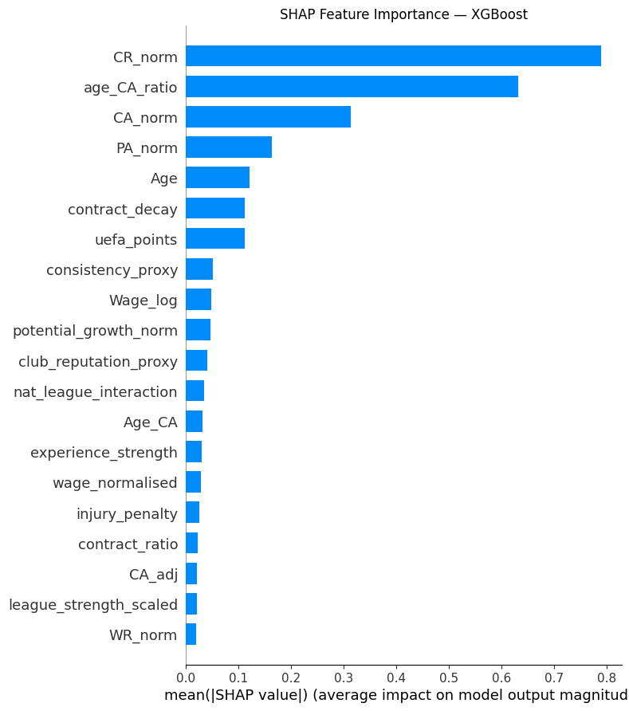
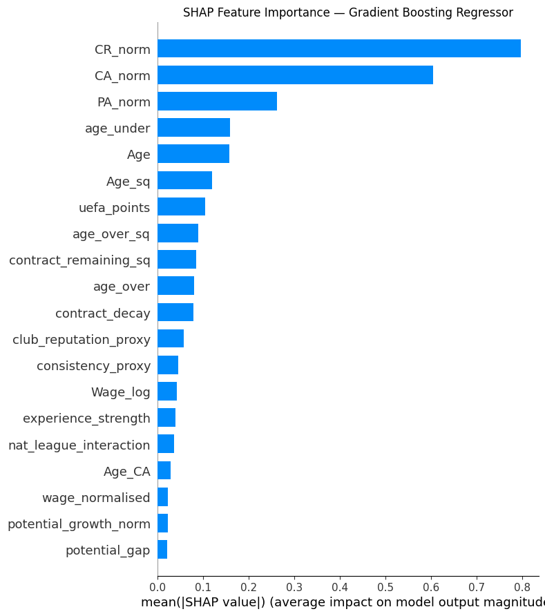
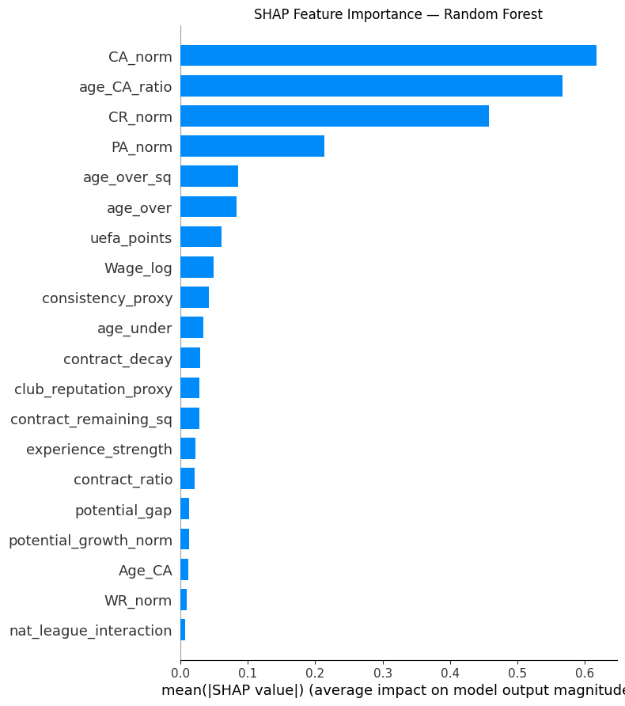

# Predicting Transfer Market Value in Football using Football Manager 2024 Data

MSc dissertation project, University of Hull (December 2025)
Author: Osasumwen Okunkpolor
Supervisor: Dr Ruben Valcarce Dineiro

## Overview

This project builds machine learning models that estimate the transfer market value of professional footballers in European leagues, using player data exported from Football Manager 2024 (FM24).

The target is `fm_value_mid`, the midpoint of the transfer value range FM24 shows for each player. Players listed as "Not for sale" (2,420 players) have no value range, so they are held out and used as a prediction set. The models are trained on the remaining 13,412 players.

Three tree based models are compared:

- Random Forest Regressor
- Gradient Boosting Regressor
- XGBoost Regressor

SHAP (TreeExplainer) is used to explain which features drive each model's predictions.

## Method

1. **Data collection.** FM24 player data was exported for European leagues and filtered to players aged 18 and over. UEFA country coefficients (`uefa_points`) and `country` were merged in manually to create `fm_with_uefa.xlsx`. This step was done outside the notebooks.
2. **Cleaning and feature engineering** (`01_data_cleaning_and_preparation.ipynb`):
   - Parsing of transfer value ranges, wages, contract expiry and heights
   - Normalised ability features (`CA_norm`, `PA_norm`, `CR_norm`, `WR_norm`)
   - `league_strength`, built from UEFA coefficients combined with an intra country scaler
   - Contract decay, age to ability ratio, elite player flag and other derived features
3. **Modelling** (notebooks 02 to 04):
   - Target transformed with `log1p` and converted back with `expm1`
   - 80/20 train/test split, `random_state=42`
4. **Post prediction adjustments** applied to the "Not for sale" predictions:
   - 3.5% value decay per year after age 27
   - 1.5% youth bonus per year under age 21
   - Position multipliers: GK 0.55, DEF 0.75, MID and FWD 1.00

## Results

Test set performance (values in GBP):

| Model | MAE | RMSE | R² | MAPE |
|---|---|---|---|---|
| Random Forest | £1,305,557 | £5,885,936 | 0.848 | 75.26% |
| Gradient Boosting | £1,233,176 | £5,661,471 | 0.860 | 71.28% |
| **XGBoost** | **£1,218,616** | **£5,494,139** | **0.868** | 71.50% |

XGBoost performed best overall, explaining about 87% of the variance in player value.

### Feature importance (SHAP)

| XGBoost | Gradient Boosting | Random Forest |
|---|---|---|
|  |  |  |

## Repository structure

```
MSc-Dissertation-FM24-Player-Valuation/
├── notebooks/
│   ├── 01_data_cleaning_and_preparation.ipynb
│   ├── 02_random_forest.ipynb
│   ├── 03_gradient_boosting.ipynb
│   └── 04_xgboost.ipynb
├── data/          # not included, see data/README.md
├── outputs/       # prediction files are written here
├── images/        # SHAP plots used in this README
├── docs/
│   └── dissertation.pdf
├── requirements.txt
└── README.md
```

## How to run

1. Clone the repository, go into this project folder and install the requirements (Python 3.12 was used):

   ```bash
   git clone https://github.com/Osasuisaac/Data-Science-and-AI-projects.git
   cd Data-Science-and-AI-projects/MSc-Dissertation-FM24-Player-Valuation
   pip install -r requirements.txt
   ```

2. Place `fm_with_uefa.xlsx` in the `data/` folder (see [data/README.md](data/README.md)).
3. Run the notebooks in order from inside the `notebooks/` folder:
   - `01_data_cleaning_and_preparation.ipynb` creates `data/fm_with_league_strength.xlsx`
   - `02`, `03` and `04` train each model and save predictions to `outputs/`

## Data

The raw data comes from Football Manager 2024, which is owned by Sports Interactive / SEGA. It is not included in this repository. See [data/README.md](data/README.md) for how to rebuild it.

## Dissertation

The full dissertation is available in [docs/dissertation.pdf](docs/dissertation.pdf).

## Limitations

- FM24 values are game estimates, not real transfer fees.
- MAPE is high (around 71% to 75%) because small errors on low value players become large percentage errors.
- Post prediction adjustments are rule based and were not learned from data.

## License

Code is released under the MIT License. The dissertation and data are not covered by this license.
